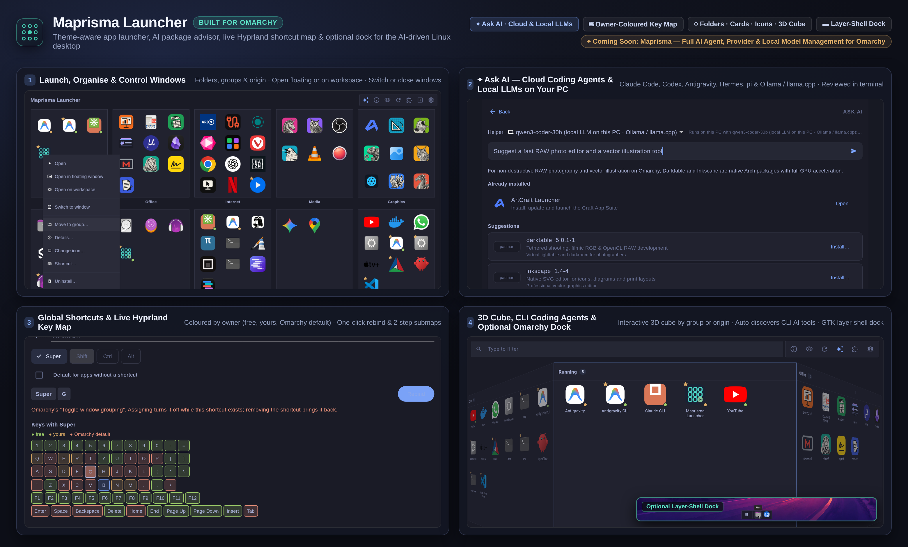

# Maprisma Launcher for Omarchy



A bar icon and shell companion for **Maprisma Launcher** — the theme-aware application launcher, AI package advisor, global shortcut manager, and optional dock built for **Omarchy** as an AI-driven Linux desktop.

---

## Highlights

### ✦ Ask AI — Cloud Coding Agents & Local LLMs on Your PC
One `✦` button in the header connects your launcher to the AI tools already on your Omarchy desktop:
- **Cloud & CLI agents:** **Claude Code** (`claude`), **Codex** (`codex`), **Antigravity** (`agy`), **Hermes** (`hermes`), and **pi** (`pi` online models).
- **100% Local LLMs on your PC:** Picks up local models configured in `~/.pi/agent/models.json` served by **Ollama** (`127.0.0.1:11434`) or **llama.cpp** (`127.0.0.1:8080`), starting the user service on demand when you click Ask — zero tokens, nothing leaves your computer.
- **Find, install, update, explain, hide or unhide:** Ask for the right tool (*"Suggest a fast RAW photo editor"*, *"What can I update?"*, *"List my hidden apps"*). The core checks every suggested package against your real package managers (`pacman`, Flatpak, and optionally AUR).
- **Safe by design:** Helpers run locked down without file, shell, or MCP tools. Nothing is installed, updated, removed, or hidden without your click, and every package command is shown first and executed in the built-in terminal. Can be turned off anytime in **Settings › Apps & AI** (the `✦` button then opens direct package search).

### ⌨ Global Shortcuts & Live Owner-Coloured Key Map
Right-click any app and choose **Shortcut…** to manage global Hyprland keybindings without hand-editing config files:
- **Visual keyboard map coloured by owner:** Select modifiers (`Super`, `Shift`, `Ctrl`, `Alt`) and see every key on your keyboard coloured live:
  - **Green (`free`):** Available to assign immediately.
  - **Yellow (`yours`):** Already assigned in your custom bindings or Maprisma Launcher.
  - **Orange (`Omarchy default`):** Used by an Omarchy default binding (shows the exact action, e.g. *Omarchy's "Toggle window grouping"*).
- **Safe one-click Rebind:** Rebinding an Omarchy key cleanly unbinds the default only while your shortcut exists; removing your shortcut automatically brings the Omarchy default back.
- **One-step & two-step submap shortcuts:** Supports both direct keys (`Super + B`) and two-step chords (`Super + Alt + Space`, then `N`), plus app-specific desktop actions (e.g. *New Private Window*).
- **Validated by Hyprland:** Writes a single managed file sourced from `~/.config/hypr/bindings.conf` and validates with Hyprland before applying.

### ⬡ Deep Omarchy Integration
- **Launch & organise your way:** Narrow **List** view (A–Z, by group, or by origin) and wide views (**Folders**, **Cards** with package sizes and sources, **Icons**, and an interactive **3D Cube** that flips between your groups and app origins).
- **Window & workspace control:** See running instance counts at a glance; right-click to **Open in floating window**, **Open on workspace 1–10**, **Switch to window**, or **Close window** (with per-window or *Close all* submenu when multiple windows are open).
- **AI coding tools on the desktop:** Automatically discovers installed CLI coding agents (`claude`, `codex`, `pi`, `hermes`, `cursor-agent`, `opencode`, `aider`, `gemini`, `qwen`, …) so you can launch, group, or bind them like any desktop app.
- **Native Omarchy look & behaviour:** Follows your active Omarchy theme colours and Hyprland window corner rounding live; closes when clicking outside on Hyprland (configurable in **Settings › General**); supports 8 interface languages (`en`, `de`, `es`, `fr`, `it`, `ja`, `pt`, `zh`) and `F12` window screenshots with notes.
- **Optional Layer-Shell Dock:** Enable **Settings › Dock** for an Omarchy screen-edge dock with pinned apps, running indicators, auto-hide, and hover magnification (uses `gtk-layer-shell`).

---

## ✦ Coming Soon: Maprisma for AI Management

**Maprisma Launcher** is the first companion in the **Maprisma** desktop suite for Omarchy. Coming soon: **Maprisma** — a dedicated visual control centre for managing AI coding agents, cloud providers, local LLM servers (`llama.cpp` / Ollama), MCP servers, skills, rules, and live token/VRAM telemetry across your Omarchy workstation.

---

## Install

This plugin provides the Omarchy bar icon and dock autostart hook. Install the **Maprisma Launcher** app first:

```sh
yay -S maprisma-launcher-bin
```

or download the AppImage from <https://github.com/maprisma/launcher/releases>, make it executable, and place it on your `PATH` as `maprisma-launcher`.

Then add the bar plugin:

```sh
omarchy plugin add https://github.com/maprisma/omarchy-maprisma-launcher
```

Remove the plugin anytime with:

```sh
omarchy plugin remove ubruckhaus.maprisma-launcher
```

(Removing the plugin leaves the `maprisma-launcher` application and your settings intact.)

---

## What the plugin does

`BarWidget.qml` runs `maprisma-launcher-toggle` when clicked. The script invokes `maprisma-launcher --toggle` (the app keeps a single window and shows or hides it). If the app is not installed yet, it displays a plain-text desktop notification with the install instruction above.

When the shell starts, the widget also runs `maprisma-launcher-toggle --dock` to launch the optional dock if enabled in **Settings › Dock** (off by default; requires the `gtk-layer-shell` package). With the dock disabled, the process exits immediately; without the app installed, nothing happens. The plugin itself installs nothing, starts no background daemon, opens no network connection, and takes no user input.

All settings, groups, and history belong to the app (`~/.config/maprisma-launcher`). On first run, the app imports existing groups and settings from the older App Manager plugin if present, leaving the old files untouched.

## Tests

`sh tests/test-toggle.sh` tests the toggle script with a mock app binary and notifier.

## License

MIT, see [LICENSE](LICENSE).
